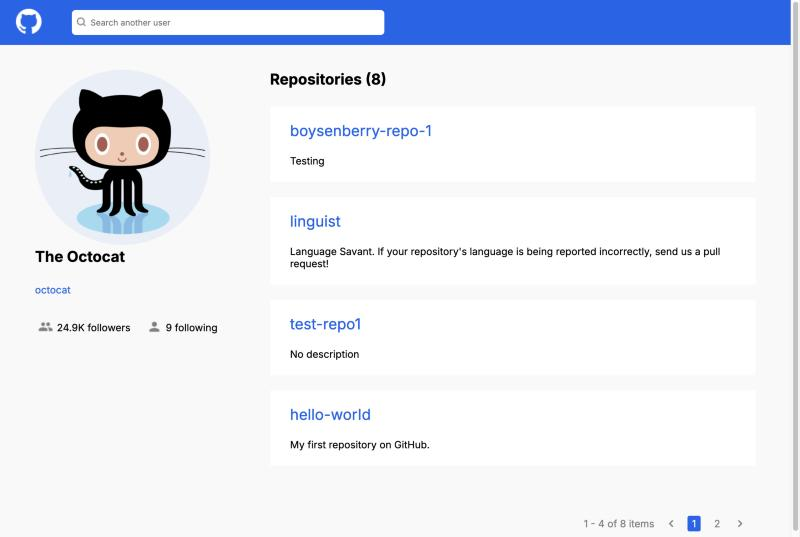
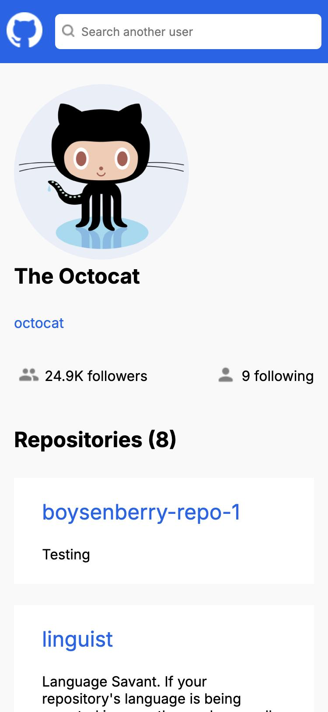

# GitHub User Search

[](https://github.com/IliaTsitovich/Project-with-API-GitHub/actions/workflows/deploy.yml)

A responsive single-page app for finding GitHub users and browsing their profiles and public repositories, built with React, TypeScript and the GitHub REST API.

**[Live demo →](https://iliatsitovich.github.io/Project-with-API-GitHub/)**


## Screenshots

| User profile                                  | User not found                                         |
| --------------------------------------------- | ------------------------------------------------------ |
|  |  |

<p align="center">
  
</p>

## Features

- Search any GitHub user by username, or start from a suggested example
- View the avatar, name, profile link and follower counts
- Browse public repositories with server-side pagination
- Clear states for loading, unknown users, empty lists, API rate limits and errors
- Responsive layout from phones to desktop
- Keyboard-friendly search form that respects `prefers-reduced-motion`

## Tech stack

| Area     | Tools                                            |
| -------- | ------------------------------------------------ |
| UI       | React 18, TypeScript, CSS Modules                |
| Build    | Vite 6                                           |
| Testing  | Vitest, React Testing Library, user-event, jsdom |
| Quality  | ESLint, Prettier                                 |
| Delivery | GitHub Actions, GitHub Pages                     |

## Getting started

Requires Node.js 20 or later.

```bash
git clone https://github.com/IliaTsitovich/Project-with-API-GitHub.git
cd Project-with-API-GitHub
npm install
npm run dev
```

Then open <http://localhost:5173/Project-with-API-GitHub/>.

No API token is needed. Unauthenticated GitHub API requests are limited to 60 per hour per IP address, and the app shows a message when that limit is reached.

## Scripts

| Command                | Description                         |
| ---------------------- | ----------------------------------- |
| `npm run dev`          | Start the development server        |
| `npm run build`        | Type-check and build for production |
| `npm run preview`      | Serve the production build locally  |
| `npm test`             | Run the tests once                  |
| `npm run test:watch`   | Run the tests in watch mode         |
| `npm run lint`         | Lint the code with ESLint           |
| `npm run format`       | Format `src` with Prettier          |
| `npm run format:check` | Check formatting without changes    |

## Project structure

```text
src/
├── api/          GitHub API requests and error type
├── components/   UI components with their styles and tests
├── hooks/        useGithubUser: search state and data loading
├── images/       Icons
├── test/         Test setup and GitHub API mocks
├── types/        GitHub API response types
├── App.tsx       Screen selection and search input state
└── config.ts     App constants
```

## How it works

Components stay presentational. All requests and their state live in the `useGithubUser` hook, which exposes a single `status` (`idle`, `loading`, `success`, `notFound`, `rateLimited` or `error`) that decides which screen is rendered.

Each new request cancels the previous one with an `AbortController`, so a slow response can never overwrite newer results. Pagination always uses the login of the user that was found, not the text currently in the search field.

## Testing

The test suite covers the hook, the main user flows and the key components. API calls are mocked with a stubbed `fetch`, so the tests run offline.

```bash
npm test
```

## Deployment

Every pull request to `main` runs the formatting check, linter, tests and build. Pushes to `main` run the same checks and then publish `dist` to the `gh-pages` branch, which serves the [live site](https://iliatsitovich.github.io/Project-with-API-GitHub/).
